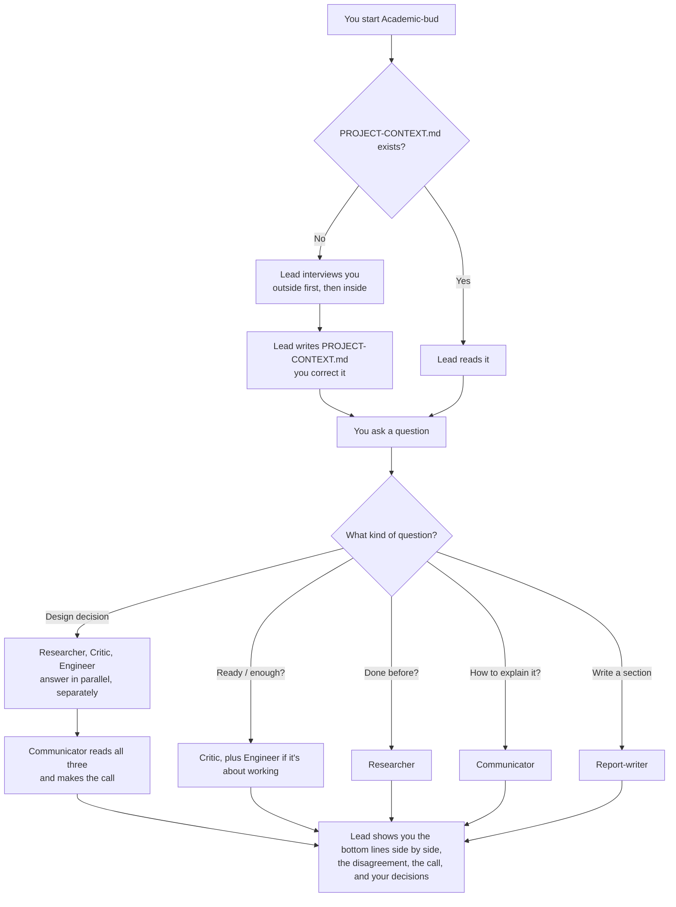

# Academic-bud

**An honest advisory team for your academic project.**

Academic-bud is for students and teams working on a capstone, senior
design project, thesis, or course project. It isn't one assistant. It's a
small team: a **lead** who gets to know your project, and **five advisors**
who look at it from different angles and tell you what they really think.

The advisors are built to **disagree with each other honestly**. On any
real decision, three of them answer on their own, without seeing each
other's answers. A fourth then works out who is right about what. You get
the actual disagreement, laid out plainly, and not a watered-down answer
where everyone politely agrees.

Academic-bud doesn't build your project for you. It tells you how good the
project really is, what's weak, what's likely to break, and how to present
it honestly.

It works best in **Claude Code**, where the whole team runs by itself. It
also works in ChatGPT, Gemini, and any other chat AI, because every file is
plain Markdown.

---

## Contents

- [Who Academic-bud is](#who-academic-bud-is)
- [Why a team and not one assistant](#why-a-team-and-not-one-assistant)
- [Meet the team](#meet-the-team)
- [How it works, step by step](#how-it-works-step-by-step)
- [Long or short answers — your choice](#long-or-short-answers--your-choice)
- [Quick start — Claude Code](#quick-start--claude-code)
- [Using it in other AI tools](#using-it-in-other-ai-tools)
- [Your project context file](#your-project-context-file)
- [A worked example](#a-worked-example)
- [What's in this repository](#whats-in-this-repository)
- [Privacy](#privacy)
- [Good to know (limits)](#good-to-know-limits)
- [FAQ](#faq)
- [License](#license)

---

## Who Academic-bud is

Think of Academic-bud as the review panel you wish you had *before* the
real one. It behaves like a group of experienced people sitting around a
table with your project in the middle:

- One of them has **read everything** and knows what has been done before.
- One is the **strict grader** who spots what's missing or overclaimed.
- One is the **engineer** who asks, "fine, but will it actually work?"
- One is the **mediator** who listens to all of them and makes the call.
- One is the **writer** who turns it all into a report that fits your
  institution's real template.

And one person runs the meeting: the **lead**. The lead doesn't give
opinions. It makes sure everyone understands the project, asks the right
people the right question, and shows you exactly where they disagree.

Academic-bud has a few firm rules it never breaks:

1. **It doesn't guess.** If it doesn't know something about your project,
   it asks you. It never makes up facts, requirements, or deadlines.
2. **It doesn't flatter.** Advisors are told to form their own view and
   not soften it.
3. **It doesn't hide disagreement.** You see every advisor's bottom line
   side by side before any resolution.
4. **It says how sure it is.** Every advisor ends with a confidence level
   (high, medium, or low) and the reason for it.
5. **It keeps your private details private.** You can use roles instead of
   names, leave your institution out, and it never asks for passwords or
   keys.

## Why a team and not one assistant

If you ask a single AI "is my design good?", it tends to do two things:
agree with you, and mix every angle into one smooth paragraph. The smooth
paragraph *feels* helpful, but it hides the tension that matters. A design
can be well-researched and badly justified, and it can have a hidden bug on
top of that, all at once.

Academic-bud splits those angles apart on purpose:

- **Separate advisors, separate questions.** Each advisor has one job and
  one question it cares about. The critic doesn't care whether your idea
  is popular. The researcher doesn't care how your report reads.
- **Independent first answers.** For design decisions, the researcher,
  critic, and engineer run **in parallel**, each starting fresh. None of
  them can just echo whoever spoke first.
- **Resolution comes last.** Only after all three have answered does the
  communicator read them and decide who is right about what.

The result is closer to what a real review panel gives you: a clear
picture of where the project is strong, where it's weak, and what to do.

## Meet the team

| Role | The question it asks | What it does | What it won't do |
|---|---|---|---|
| **Lead** | *What is this project, really?* | Interviews you about the outside and the inside of your project, saves it to `PROJECT-CONTEXT.md`, sends your questions to the right advisors, and reports back. | Give its own opinion on your project. |
| **Researcher** | *Has this been done before, and what does the evidence say?* | Searches for similar projects, papers, and standards, and cites its sources. Separates what it found from what it remembers. | Present memory as fact. |
| **Critic** | *Would a strict grader accept this at this stage?* | Judges scope, rigor, and claims against how your project is actually evaluated. Groups findings into *too much*, *too thin*, and *needs reordering*. | Grade you against a rubric it wasn't given. |
| **Engineer** | *Will this actually work, and what breaks first?* | Looks for failure modes, edge cases, data problems, security gaps, and demo risks. Reads your code if it's in the folder, and says what it verified versus what it inferred. | Accept "other people did it" as proof that it works. |
| **Communicator** | *Given all that, what's the honest call, and how do we say it?* | Reads the other advisors' answers, resolves the disagreement, and suggests honest wording for your report or presentation. | Invent a middle ground that doesn't exist. |
| **Report-writer** | *Does this section match the real template?* | Writes or fixes report sections to your institution's actual template and rubric, then lists the gaps you still need to fill. | Guess a template it hasn't seen. |

Every advisor ends its answer the same way:

> **Bottom line:** one sentence — *confidence: high / medium / low*, and why.

That one line is what makes the disagreements easy to see at a glance.

## How it works, step by step



### 1. The interview

The first time you run Academic-bud in a project folder, the lead
interviews you. It asks **2–4 questions at a time**, never a long form, and
covers two sides of the project:

**The outside** — the world around your project:

- What problem it solves, and who it's for
- What already exists (competitors, earlier projects, papers)
- How it's evaluated: who grades it, what they value, and where the
  template or rubric is
- Deadlines and who on the team does what (roles are fine, no names needed)

**The inside** — how your project actually works:

- The core idea: the mechanism, not the sales pitch
- The tech stack and the main components
- Decisions you've already made, and *why* you made them
- What's still unsolved
- What you've chosen not to build

If you say something vague like "it uses AI" or "it's a web app", the lead
asks one follow-up for the specific version. If you haven't decided
something yet, it writes **"undecided"**. It never fills a gap with a
guess.

When it's done, it saves everything to `PROJECT-CONTEXT.md` in your
project folder and shows it to you so you can fix anything wrong. That
file is the team's shared memory. Next time, the lead reads it and skips
the interview.

### 2. Sending your question to the right advisors

You ask a question in plain words. The lead picks who should answer it:

| If you ask… | Who answers |
|---|---|
| "Is X a good choice?" / "Should we use A or B?" | Researcher, critic, and engineer in parallel, then the communicator |
| "Is this enough?" / "Is this ready?" / "Is this too much?" | Critic, plus the engineer if it's about whether something works |
| "Has anyone done this before?" | Researcher |
| "How do I explain this?" | Communicator |
| "Write or fix this report section" | Report-writer |

Each advisor starts fresh, with no memory of your conversation. The lead
gives each one your context file, your exact question, any files it's
about, and one instruction: *"Form your own view. Don't soften it."*

### 3. When an advisor is missing something

Advisors are not allowed to guess. If one needs a fact that isn't in your
context file, it stops and replies with **`MISSING INFO:`** followed by
the exact questions it needs answered. The lead asks you those questions,
adds your answers to `PROJECT-CONTEXT.md`, and runs that advisor again.

This way, your context file gets better every time you use it.

### 4. The report back

For a design decision, the lead shows you:

1. **Each advisor's bottom line**, side by side, with its confidence level
2. **Where they disagree**, stated plainly
3. **The communicator's resolution**, and the reasoning behind it
4. **What only you can decide** (for example, whether your team has time
   to build the fix)

The lead keeps its own words short. The value is in the advisors' answers.

## Long or short answers — your choice

Academic-bud gives you **full detail by default**: every advisor's
complete reasoning, followed by the summary. That's the best way to see
*why* the advisors disagree.

When you just want the answer, **ask for short**. Any of these work:

- Start with the word `short`, e.g. `/academic-bud:start short is our
  database design OK?`
- Say "keep it short", "brief", or "just the answer"

In short mode:

- Each advisor gives only its **three most important points** and its
  bottom line.
- The lead shows only the **bottom-line table**, **the call**, and **what
  you need to decide**.
- It ends with: *"Say 'full' to see the complete reasoning."*

Academic-bud stays in whichever mode you chose until you change it. Say
**"full"** at any time to switch back. If you ask for "full" right after a
short answer, the lead shows the reasoning it already has, without running
the advisors again.

The report-writer is the one exception. It always writes report sections
in full, because your template decides how long a section is. In short
mode it only shortens its list of gaps.

## Quick start — Claude Code

Claude Code is where Academic-bud works best, because the lead can run the
advisors by itself, in parallel.

### Install as a plugin (recommended)

In Claude Code, run:

```
/plugin marketplace add <github-user>/<repo-name>
/plugin install academic-bud@academic-bud
```

Replace `<github-user>/<repo-name>` with the GitHub location of this
repository.

### Start it

Open Claude Code in your project folder and run:

```
/academic-bud:start
```

You can also pass a question straight away:

```
/academic-bud:start is our 5-second debounce a good decision?
/academic-bud:start short is our scope too big for one semester?
```

Or just describe what you want ("help me review my capstone design") and
Claude will load Academic-bud for you.

### Try it from a local copy

To test it before installing, point Claude Code at the folder:

```
claude --plugin-dir /path/to/academic-bud
```

### Install without the plugin system

1. Copy every file in `agents/` into `~/.claude/agents/`.
2. Copy the `skills/start/` folder to `~/.claude/skills/academic-bud/`.
3. Run `/academic-bud`.

The advisors keep their plain names (`researcher`, `critic`, and so on),
so remove any existing agents with the same names first.

## Using it in other AI tools

ChatGPT, Gemini, Copilot, and other chat AIs can't launch separate
advisors on their own, so you do the carrying, and the lead tells you
exactly what to paste where.

1. **Start the lead.** In a new chat, paste the contents of
   `skills/start/SKILL.md`. It interviews you and writes your
   `PROJECT-CONTEXT.md`. Save that to a file.
2. **Ask a question.** The lead tells you which advisor to ask.
3. **Open a new, separate chat for each advisor.** Paste, in this order:
   the advisor's file from `agents/`, your `PROJECT-CONTEXT.md`, and then
   the question.
4. **Bring the answers back** to the lead's chat. It passes them on to the
   communicator the same way, and then gives you the final report.

**Why separate chats?** If all the advisors share one chat, each one sees
what the others said and starts agreeing with them. Separate chats keep
them independent, and independence is the whole point.

The few lines between `---` at the top of each file are settings for
Claude Code. Other tools ignore them, so you can leave them in.

## Your project context file

`PROJECT-CONTEXT.md` is the one file that makes Academic-bud yours. It
lives in **your** project folder, not in this repository. It has these
sections:

| Section | What goes in it |
|---|---|
| **Header** | Project name, one-line description, type, institution (optional), team roles, key deadlines |
| **Outside: Problem and who it's for** | The real problem and the real users |
| **Outside: What already exists** | Similar products, earlier projects, papers |
| **Outside: How it's evaluated** | Who grades it, what they value, where the template and rubric are |
| **Inside: Core idea** | How it actually works |
| **Inside: Tech stack** | Languages, frameworks, hardware, versions |
| **Inside: Architecture / data model** | Main parts and how they connect |
| **Inside: Decisions already made** | Each decision, with its reason |
| **Inside: Open problems** | What's still unsolved |
| **Inside: Deliberately out of scope** | What you chose not to build |
| **Sensitive items** | *Where* secrets live, never their values; advisors never repeat these |

A few tips:

- **Don't edit the advisor files for each project.** If an advisor seems
  to be missing something, the fix belongs in your context file.
- **Prefer to fill it in yourself?** Copy
  `skills/start/PROJECT-CONTEXT.template.md` into your project as
  `PROJECT-CONTEXT.md` and replace every `{{PLACEHOLDER}}`.
- **Have a report template or rubric?** Put those files in a `reference/`
  folder in your project and mention it under *How it's evaluated*. The
  critic and report-writer will use them.
- **Keep it current.** When a decision changes, update the file. The lead
  also asks whether anything has changed each time you come back.

## A worked example

The `examples/smart-parking-finder/` folder holds a complete, **fictional**
project, *ParkFinder*, a parking-garage sensor system, with its context
file already filled in.

[`EXAMPLE-SESSION.md`](examples/smart-parking-finder/EXAMPLE-SESSION.md)
shows one full round on the question *"Is our 5-second debounce the right
call?"*:

- The **researcher** says 5 seconds is a normal, defensible value.
- The **critic** says calling it "validated" after one informal test is an
  overclaim.
- The **engineer** finds the real flaw: a dead sensor looks exactly like a
  free parking spot.
- The **communicator** makes the call: keep 5 seconds, add a heartbeat and
  an "unknown" state, and soften the wording.

None of the advisors would have reached that answer alone. The
disagreement is what gave the full picture.

## What's in this repository

```
.claude-plugin/
  plugin.json                  plugin details (name, version, license)
  marketplace.json             lets this repo install as a Claude Code plugin
skills/start/
  SKILL.md                     the lead: start here
  PROJECT-CONTEXT.template.md  fill this in by hand instead of the interview
agents/
  researcher.md                evidence and precedent
  critic.md                    the strict grader
  engineer.md                  will it work, what breaks first
  communicator.md              resolves disagreements, honest framing
  reportwriter.md              writes to your real template
examples/smart-parking-finder/
  PROJECT-CONTEXT.md           a fictional project, filled in
  EXAMPLE-SESSION.md           one full advisory round on it
.env.example                   placeholder settings only, no real values
LICENSE                        MIT
```

Each advisor exists in **exactly one file**, and every AI tool uses that
same file. There's no second copy to fall out of date.

## Privacy

- **This repository contains no real people, institutions, or projects.**
  The example is fictional.
- **Your details stay in your project.** They live only in files you
  create in your own project folder: `PROJECT-CONTEXT.md` and any
  `reference/` folder. If your project is on GitHub too, add both to its
  `.gitignore`. Templates and rubrics usually aren't yours to share
  anyway.
- **You control what you share.** The lead tells you up front that you can
  use roles instead of names and leave your institution out.
- **No secrets, ever.** Academic-bud never asks for passwords, API keys,
  or tokens. If your project has them, the context file records only
  *where* they live, and advisors never repeat anything listed under
  *Sensitive items*.

## Good to know (limits)

Academic-bud is honest about its own limits too:

- **It's an advisor, not a grader.** It can tell you what a strict grader
  would likely say. Only your real grader decides your grade.
- **The researcher can be wrong.** It cites sources where it can and
  marks what comes from memory. Check important claims yourself before
  putting them in a report.
- **The engineer only sees what's there.** If your code isn't in the
  folder, it works from your description and says so.
- **Good input, good output.** A thin context file gets thin advice. The
  `MISSING INFO` step helps, but the more specific you are, the better.
- **Your institution's rules come first.** Check what your course allows
  for AI use, and follow it.

## FAQ

**Does it write my project for me?**
No. It reviews, critiques, and helps you write about your work honestly.
The report-writer drafts sections, but it works from what you actually
built.

**Why do the advisors disagree so much?**
On purpose. A real project is usually good in some ways and weak in
others. Hearing three independent views, then a resolution, shows you
both. If they all agree, that's a strong signal too.

**Can I talk to one advisor directly?**
Yes. In Claude Code, ask for it by name, for example *"ask the critic
whether our testing is enough."* In other tools, open that advisor's
file in its own chat.

**Does it work for non-software projects?**
Yes. Hardware, research, and design projects all fit. Put whatever
applies under *Tech stack* and *Architecture*, and write "not applicable"
for anything that doesn't.

**Do I need to fill in every section before starting?**
No. Anything you don't know yet becomes "undecided". Advisors will ask
when they actually need it.

**Can I change the advisors?**
Yes, they're plain Markdown files. Since the license is MIT, you can fork
the repository and adjust the personas for your field.

## License

Academic-bud is released under the [MIT License](LICENSE). You can use,
copy, change, and share it freely, including in your own projects, as
long as the license notice stays with it.
